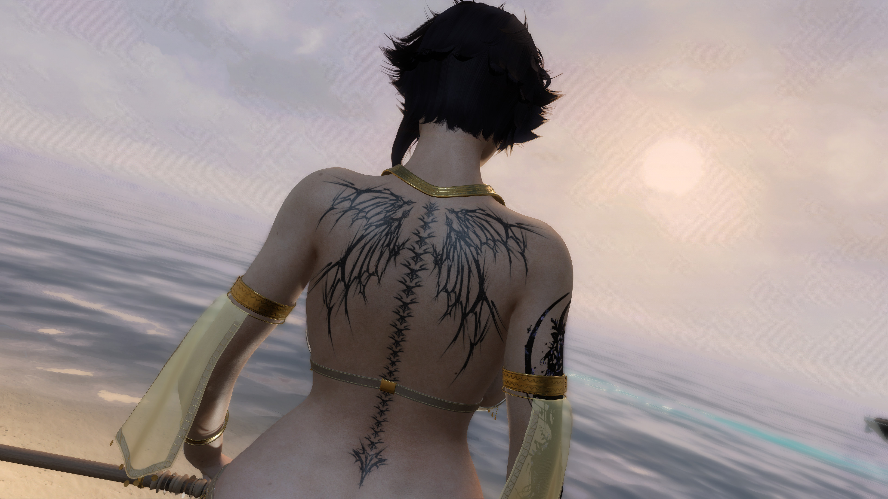

# Tinesh's Sun Dancer - A UBE Outfit and the Eclipse Scythe for Skyrim SE/AE

A sun dancer-inspired outfit made for **UBE 2.0 (Ultimate Body Enhancer)**, featuring white linen, gold details, dark
leather and sheer saffron cloth, along with the obsidian-and-gold **Eclipse Scythe**.

Includes 11 light armor pieces, three hip options, SMP cloth physics, full BodySlide support and 2K, 4K or 8K
textures. Optional PBR textures are available for PG Patcher.



**[Download the latest release](https://github.com/71Kevin/sun-dancer-se/releases/latest)** · Also on
[Nexus Mods](https://www.nexusmods.com/skyrimspecialedition/mods/200125)

## Features

- **11 light armor pieces:** Wrap, three hip options, arm veils, bracelets, collar, sandals, armlets, circlet and navel
  charm.
- **Three hip options:** Loincloth with briefs, loincloth without briefs, or briefs alone. They share slot 52, so only
  one can be equipped at a time.
- **SMP physics** for the loincloth panels and arm veils.
- **Full BodySlide support** for UBE 2.0 sliders, including Build Morphs.
- **Eclipse Scythe:** two-handed weapon using battleaxe animations, with the unique Eclipse Brand enchantment.
- **Craftable** at any forge and **temperable**, with no perks required.
- **2K, 4K and 8K texture options**, plus optional PBR add-ons for Community Shaders with TruePBR.
- ESL-flagged plugin that adds new records only. Masters: `Skyrim.esm` and `UBE_AllRace.esp`.

## Downloads

Install **one** main outfit package. All versions include the same plugin, meshes, physics and BodySlide files; only
the texture resolution changes. PBR add-ons are optional and install separately on top of a main file. The same files
are on the [Nexus Mods page](https://www.nexusmods.com/skyrimspecialedition/mods/200125?tab=files).

| Package | Download (version 1.0) |
|---|---|
| Outfit - 2K | [Sun-Dancer-UBE-2K-1.0.7z](https://github.com/71Kevin/sun-dancer-se/releases/download/v1.0/Sun-Dancer-UBE-2K-1.0.7z) |
| Outfit - 4K | [Sun-Dancer-UBE-4K-1.0.7z](https://github.com/71Kevin/sun-dancer-se/releases/download/v1.0/Sun-Dancer-UBE-4K-1.0.7z) |
| Outfit - 8K | [Sun-Dancer-UBE-8K-1.0.7z](https://github.com/71Kevin/sun-dancer-se/releases/download/v1.0/Sun-Dancer-UBE-8K-1.0.7z) |
| PBR add-on - 2K | [Sun-Dancer-PBR-PG-Patcher-2K-1.0.7z](https://github.com/71Kevin/sun-dancer-se/releases/download/v1.0/Sun-Dancer-PBR-PG-Patcher-2K-1.0.7z) |
| PBR add-on - 4K | [Sun-Dancer-PBR-PG-Patcher-4K-1.0.7z](https://github.com/71Kevin/sun-dancer-se/releases/download/v1.0/Sun-Dancer-PBR-PG-Patcher-4K-1.0.7z) |
| PBR add-on - 8K | [Sun-Dancer-PBR-PG-Patcher-8K-1.0.7z](https://github.com/71Kevin/sun-dancer-se/releases/download/v1.0/Sun-Dancer-PBR-PG-Patcher-8K-1.0.7z) |

Release notes and SHA-256 checksums: [v1.0](https://github.com/71Kevin/sun-dancer-se/releases/tag/v1.0). See
[CHANGELOG.md](CHANGELOG.md) for changes.

### PBR add-on

The PBR add-on contains only the PBR textures and PG Patcher configuration. It does not replace the main outfit
package. Install it separately, then run PG Patcher with TruePBR after BodySlide.

The add-on's resolution can be chosen independently from the main file. Once PG Patcher has run, the game uses the PBR
textures, so the 2K main package is sufficient when using the add-on.

## Requirements

- Skyrim Special Edition or Anniversary Edition.
- [UBE 2.0](https://www.nexusmods.com/skyrimspecialedition/mods/92989) (U.0.7 or later), with all its requirements:
  [RaceCompatibility](https://www.nexusmods.com/skyrimspecialedition/mods/2853),
  [XP32 Maximum Skeleton Special Extended](https://www.nexusmods.com/skyrimspecialedition/mods/1988),
  [RaceMenu](https://www.nexusmods.com/skyrimspecialedition/mods/19080),
  [CBPC](https://www.nexusmods.com/skyrimspecialedition/mods/21224),
  the physics configuration from [CBBE 3BA](https://www.nexusmods.com/skyrimspecialedition/mods/30174),
  and [FSMP - Faster HDT-SMP](https://www.nexusmods.com/skyrimspecialedition/mods/57339), with SKSE and Address
  Library.
- [BodySlide and Outfit Studio](https://www.nexusmods.com/skyrimspecialedition/mods/201) (x64).

FSMP provides physics for the loincloth panels and arm veils. Without it, they remain still. RaceMenu handles BodyMorph
and the sandals' height adjustment.

**Optional for PBR:** [PG Patcher](https://www.nexusmods.com/skyrimspecialedition/mods/120946) 2.4+ and
[Community Shaders](https://www.nexusmods.com/skyrimspecialedition/mods/86492) with TruePBR.

No DLC is required. The plugin itself does not require an SKSE plugin.

## Installation

1. Install **one** main outfit package with your mod manager.
2. In BodySlide, select the **Sun Dancer** group, choose your UBE preset, enable **Build Morphs** and run **Batch
   Build**. The circlet and scythe do not need BodySlide.
3. Enable `[Tinesh] Sun Dancer.esp`.
4. **Optional PBR:** install one PBR add-on separately and run PG Patcher with TruePBR enabled after BodySlide.

Run Batch Build again after changing texture packages or updating the mod. If using PBR, run PG Patcher again after
rebuilding.

## Crafting and items

All pieces are light armor and can be crafted at any forge without perks. The outfit as a whole has an armor rating
similar to a leather armor set.

| Item | Slot | Recipe |
|---|---:|---|
| Sun Dancer Wrap | 32 | 1 Linen Wrap, 1 Leather Strips, 1 Gold Ingot |
| Loincloth with Briefs | 52 | 3 Linen Wrap, 1 Leather Strips, 1 Gold Ingot |
| Loincloth without Briefs | 52 | 2 Linen Wrap, 1 Leather Strips, 1 Gold Ingot |
| Briefs | 52 | 1 Linen Wrap, 1 Gold Ingot |
| Sandals | 37 | 1 Leather, 2 Leather Strips |
| Bracelets | 34 | 1 Gold Ingot |
| Armlets | 58 | 1 Gold Ingot |
| Arm Veils | 59 | 1 Linen Wrap, 1 Gold Ingot |
| Collar | 45 | 1 Gold Ingot, 1 Leather Strips |
| Circlet | 42 | 1 Gold Ingot |
| Navel Charm | 49 | 1 Gold Ingot |
| Eclipse Scythe | Two-handed | 3 Steel Ingots, 1 Gold Ingot, 1 Leather Strips, 1 Fire Salts |

Tempering: cloth and leather pieces use Leather Strips (the Briefs use Linen Wrap); gold pieces use a Gold Ingot; the
scythe uses a Steel Ingot.

Console: `help "sun dancer" 4` or `help "eclipse scythe" 4`, then `player.additem <ID> 1`.

### Eclipse Scythe

The two-handed scythe uses battleaxe animations and has 19 base damage, 1.35 reach and 0.7 speed.

Its **Eclipse Brand** enchantment has about 100 hits per charge and can be recharged with soul gems. It cannot be
disenchanted.

- **Solar Flare:** deals 10 points of sunfire damage.
- **Corona:** deals 10 additional damage to undead; fire resistance does not apply.
- **Umbra:** one hit in four drains 25 stamina.

## Compatibility

- Made for **UBE 2.0 female characters only**, including UBE human and elf races and vampires.
- Not made for CBBE, CBBE 3BA, BHUNP, UNP, vanilla bodies or male characters.
- Adds new records only; no vanilla records are changed. It can be added to an existing save.
- The three hip options share slot 52 and replace one another.
- The BodySlide files include UBE's own sliders. Third-party UBE sliders are not included.
- SMP cloth physics only runs on characters currently simulated by FSMP; other characters may show the panels and
  veils still.
- Very deep crouches may cause minor clipping around the briefs and loincloth. Very voluminous hairstyles may overlap
  the circlet.

## How it was made

The outfit was modelled, rigged and textured from scratch using Blender, PyNifly and Python scripts. Mutagen was used
to create the plugin. No meshes or textures were taken from other mods.

The Wrap carries the UBE body and the Sandals carry the UBE feet, as required by their body and footwear slots.

## Building from source

The repository includes the build pipeline used to create the release packages.

### Tools

- Blender 4.5 LTS with PyNifly 29
- Python 3 with NumPy, SciPy, OpenCV and lz4
- texconv (DirectXTex), .NET 9 SDK and 7-Zip
- UBE 2.0 and XP32 Maximum Skeleton Special Extended installed in a Mod Organizer 2 mods folder

Set the reference mod folder names in `tools/extract_refs.py` and the game `Data` folder in `build.ps1`, then run from
PowerShell:

```powershell
.\build.ps1 -Public                 # Build all public release packages
.\build.ps1 -Public -Resolutions 8K # Build only the 8K package
.\build.ps1 -Install                # Also install the 8K package in MO2
```

`-Public` includes only UBE's own sliders in the packaged BodySlide data. Tool and folder paths can be configured
through the script parameters.

The clipping tests and preview renders use UBE's zeroed sliders by default. To test your own BodySlide presets, list
them in `tools/presets.local.json` (not tracked; start from `tools/presets.example.json`). They never change the
packages.

## Credits and permissions

- **Tinesh:** design, meshes, textures, physics and plugin.
- **UBE 2.0** by johnybungalow1 and lowresOutis: UBE body parts and slider data used by the outfit.
- **Bethesda Game Studios:** referenced base-game assets, effects and animations; the enchantment's palettes are
  recoloured from the game's effect gradients.
- **FSMP / HDT-SMP authors:** physics system.
- **ousnius and Caliente:** BodySlide and Outfit Studio.
- Tools: Blender, PyNifly, Mutagen, DirectXTex and 7-Zip.

If you enjoy my mods and want to support future projects, you can [buy me a coffee on Ko-fi](https://ko-fi.com/tinesh).
